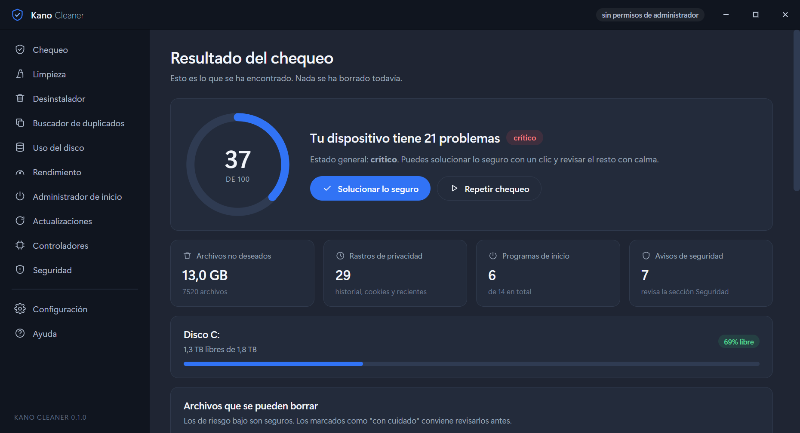
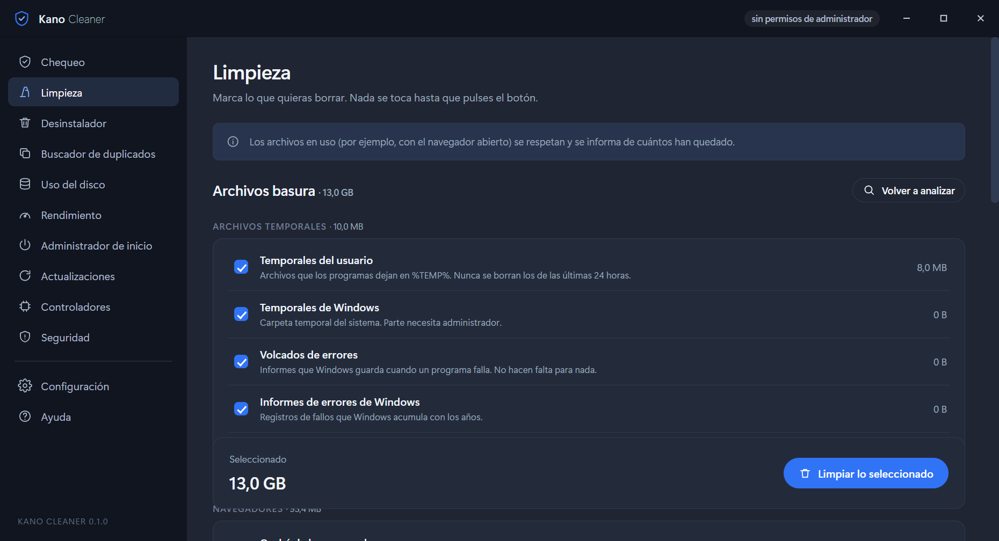
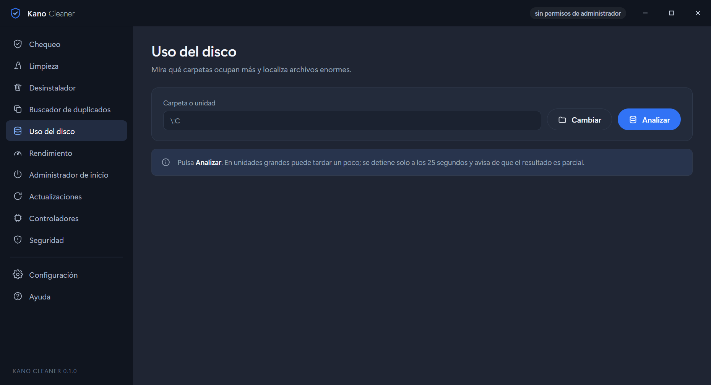
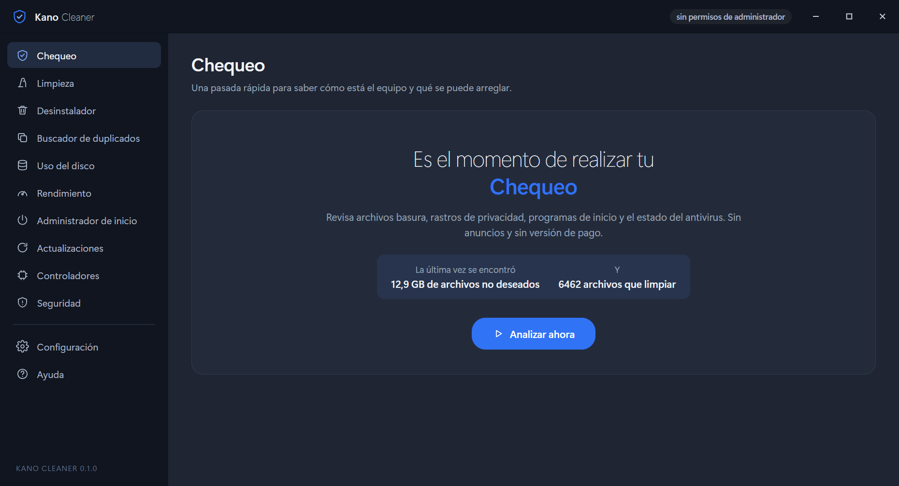
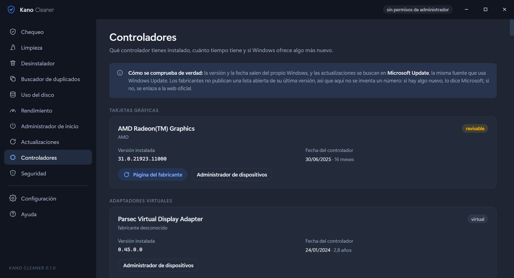

# Kano Cleaner

**Windows 10 and 11 cleaner and health checker. Free, no Pro version, no ads, no telemetry.**

[Versión en español](README.md) · [Download the latest release](../../releases/latest)



---

## What it is

A desktop app that cleans your PC and tells you the truth about its state. No account, no
sign-up, no network connections on its own, and nothing left running in the background.

It is meant as a free alternative to CCleaner 7: the sections people actually use, with no
locks, no "premium" badges and no *Upgrade now* button.

## Download

1. Go to **[Releases](../../releases/latest)**.
2. Download `KanoCleaner-x.x.x-portable.exe`.
3. Double-click. Nothing is installed: it is a single portable file.

A `SHA256SUMS.txt` file is published alongside it so you can verify the download.

### The blue Windows warning (important)

The first time, Windows may show **"Windows protected your PC"**. That is expected: the
file is not code-signed, and signing costs money every year. It does not mean the file is
malware; it means Microsoft does not know the author.

To open it:

1. Click **More info**.
2. Click **Run anyway**.

You can read all the source code right here: it is exactly what gets built for every
release, automatically and publicly (see [`.github/workflows`](.github/workflows)).

## Features

| Section | What it does |
|---|---|
| **Checkup** | Score from 0 to 100, a summary of problems and a one-click fix for the safe ones. |
| **Cleaning** | 18 junk and privacy categories: temp files, browser caches, thumbnails, error reports, Windows Update leftovers, history, cookies, recycle bin… |
| **Uninstaller** | Lists installed programs, opens their real uninstaller and finds leftovers. |
| **Duplicate finder** | Finds identical files by comparing **content**, not names. |
| **Disk usage** | Measures which folders take the most space and finds huge files. |
| **Performance** | Memory usage, uptime and the hungriest processes (informational only). |
| **Startup manager** | Enable or disable startup programs, just like Windows Task Manager. |
| **Updates** | Updates installed programs through `winget`, Microsoft's official package manager. |
| **Drivers** | Driver version and date for each graphics card, a real update search on Microsoft Update, and a list of faulty devices. |
| **Security** | Real Windows Defender status, threat history, quick or full scans, plus extra checks. |
| **Settings and Help** | Light or dark theme, administrator permissions and plain-language explanations. |

## What it deliberately does **not** do

- **No registry cleaning.** It does not speed anything up and it can break programs.
- **No made-up drivers.** Updates come from Microsoft Update, the same source Windows
  Update uses, plus links to the vendor's official page. Nothing is ever downloaded from a
  random site, and no "new version" is invented.
- **No force-killing processes.** That loses unsaved work.
- **It is not an antivirus.** It uses the real **Windows Defender** engine, which is the
  only thing allowed to scan the whole disk. Pretending otherwise would be dangerous.
- **No data collection.** The only network calls are the ones you ask for: `winget`
  updates, the Microsoft Update driver search and Defender scans.

## Safety when deleting

- Anything deleted from **Duplicates** or **Leftovers** goes to the **Recycle Bin**.
- Regular cleaning deletes directly, because those are temp files Windows recreates.
- Risky categories (recycle bin, Prefetch, `Windows.old`, cookies) are marked
  **handle with care** and are never pre-selected.
- Files in use are skipped, and the app tells you how many were left behind.

## Screenshots

| Cleaning | Disk usage |
|---|---|
|  |  |

| Checkup | Drivers |
|---|---|
|  |  |

## Requirements

- Windows 10 (1809 or later) or Windows 11, 64-bit.
- About 120 MB of free disk space.
- Optional: `winget` for the updates section (ships with the Microsoft Store *App
  Installer*).
- Optional: administrator rights for system folders and machine-wide startup entries.

## Build from source

Requires [Node.js](https://nodejs.org/) 20 or newer.

```powershell
git clone https://github.com/Kano-ko/kano-cleaner.git
cd kano-cleaner
npm install
npm start        # run in development
npm run dist     # build the portable .exe into release/
```

No UI framework: plain HTML, CSS and JavaScript, plus PowerShell to talk to Windows. The
structure is explained in [`AGENTS.md`](AGENTS.md) (in Spanish).

## Contributing

Bug reports and ideas are welcome in [Issues](../../issues). Please read
[`CONTRIBUTING.md`](CONTRIBUTING.md) first. For security issues, follow
[`SECURITY.md`](SECURITY.md) instead of opening a public issue.

## License

[MIT](LICENSE). Use it, copy it, modify it and redistribute it, including commercially, as
long as you keep the copyright notice.

The software is provided **as is**, without warranty. It deletes files: use it sensibly and
keep backups of anything you care about.
