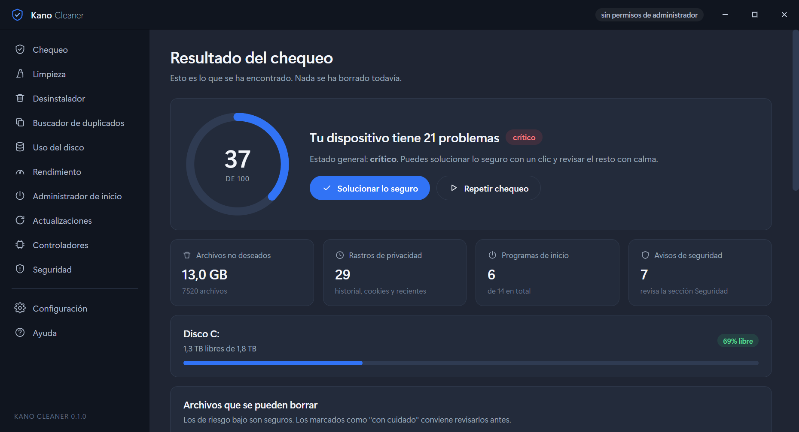
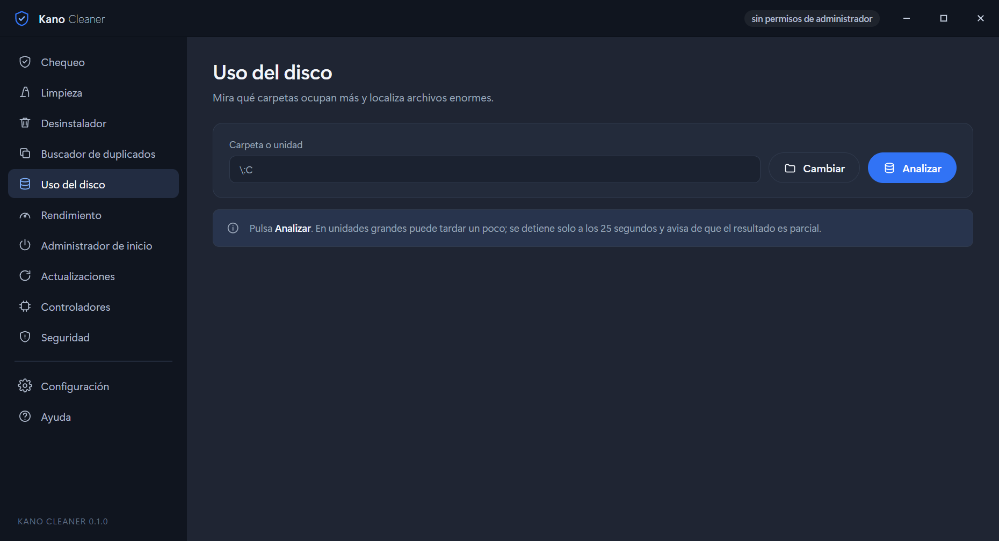
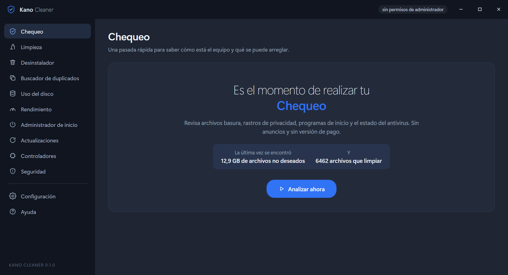
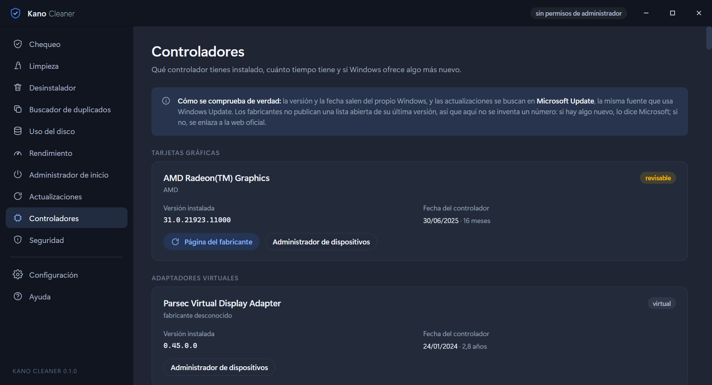

# Kano Cleaner

**Limpiador y comprobador para Windows 10 y 11. Gratis, sin versión Pro, sin anuncios y sin telemetría.**

[English version](README.en.md) · [Descargar la última versión](../../releases/latest)



---

## Qué es

Una aplicación de escritorio que limpia el equipo y dice la verdad sobre su estado. No
tiene cuentas, no se registra en ningún sitio, no abre conexiones a internet por su cuenta
y no se queda corriendo en segundo plano.

Está pensada como alternativa libre a CCleaner 7: las mismas secciones que se usan de
verdad, sin candados, sin insignias de "premium" y sin el botón de *Actualizar ahora*.

## Descargar

1. Entra en **[Releases](../../releases/latest)**.
2. Descarga `KanoCleaner-x.x.x-portable.exe`.
3. Doble clic. No se instala nada: es un único archivo portable.

Si quieres comprobar que la descarga está íntegra, en la misma página hay un archivo
`SHA256SUMS.txt` con la huella de cada `.exe`.

### El aviso azul de Windows (importante)

La primera vez, Windows puede mostrar **"Windows protegió tu PC"**. Es normal: el archivo
no está firmado digitalmente, y firmar cuesta dinero cada año. No significa que tenga un
virus; significa que Microsoft no conoce al autor.

Para abrirlo:

1. Pulsa **Más información**.
2. Pulsa **Ejecutar de todas formas**.

Puedes revisar el código entero aquí mismo: es lo que se compila en cada versión, de forma
automática y pública (ver [`.github/workflows`](.github/workflows)).

## Qué hace

| Sección | Para qué sirve |
|---|---|
| **Chequeo** | Puntuación de 0 a 100, resumen de problemas y botón para arreglar lo seguro de una vez. |
| **Limpieza** | 18 categorías de basura y privacidad: temporales, cachés de navegadores, miniaturas, informes de errores, restos de Windows Update, historial, cookies, papelera… |
| **Desinstalador** | Lista los programas instalados, abre su desinstalador real y busca restos que se quedan. |
| **Buscador de duplicados** | Encuentra archivos idénticos comparando el **contenido**, no el nombre. |
| **Uso del disco** | Mide qué carpetas ocupan más y localiza archivos enormes. |
| **Rendimiento** | Memoria usada, tiempo encendido y los procesos que más consumen (solo informa). |
| **Administrador de inicio** | Activa o desactiva programas que arrancan con Windows, igual que el Administrador de tareas. |
| **Actualizaciones** | Actualiza programas instalados usando `winget`, el gestor oficial de Microsoft. |
| **Controladores** | Versión y fecha del controlador de cada tarjeta gráfica, búsqueda real de actualizaciones en Microsoft Update y lista de dispositivos con problemas. |
| **Seguridad** | Estado real de Windows Defender, historial de amenazas, análisis rápido o completo y comprobaciones propias. |
| **Configuración y Ayuda** | Tema claro u oscuro, permisos de administrador y explicaciones sin rodeos. |

## Qué **no** hace, y por qué

- **No limpia el registro.** No acelera nada y puede romper programas. Es la mitad del
  negocio de los limpiadores comerciales y es humo.
- **No inventa controladores.** Se consulta Microsoft Update, que es la misma fuente que
  usa Windows Update, y se enlaza a la web del fabricante. Nunca se descarga un controlador
  de un sitio raro ni se muestra una "versión nueva" que no exista.
- **No cierra procesos por su cuenta.** Cerrar el equivocado hace perder trabajo sin
  guardar. Para eso está el Administrador de tareas.
- **No es un antivirus.** Sería irresponsable fingir uno: hace falta un equipo, años de
  firmas y un controlador firmado. Aquí se usa el motor real de **Windows Defender**, que
  es el que tiene permiso para analizar todo el disco.
- **No manda datos a ningún sitio.** No hay analíticas, ni cuentas, ni "mejora de la
  experiencia". Las únicas salidas a internet son las que tú pides: actualizar con
  `winget`, buscar controladores en Microsoft Update y analizar con Defender.

## Seguridad al borrar

- Lo que se borra desde **Duplicados** o **Restos** va a la **papelera de reciclaje**: se
  puede recuperar.
- La limpieza normal borra directamente, porque son archivos temporales que Windows
  regenera solo.
- Las categorías delicadas (papelera, Prefetch, `Windows.old`, cookies) están marcadas
  como **con cuidado** y nunca se marcan solas.
- Los archivos en uso se respetan y la aplicación dice cuántos han quedado.

## Capturas

| Limpieza | Uso del disco |
|---|---|
|  |  |

| Chequeo | Controladores |
|---|---|
|  |  |

## Requisitos

- Windows 10 (1809 o posterior) o Windows 11, 64 bits.
- Unos 120 MB de espacio libre.
- Opcional: `winget` para la sección de actualizaciones. Viene con la app *Instalador de
  aplicaciones* de la Microsoft Store.
- Opcional: permisos de administrador para limpiar carpetas del sistema y cambiar entradas
  de inicio del equipo. Sin ellos funciona igual, pero con menos alcance.

## Compilar desde el código

Hace falta [Node.js](https://nodejs.org/) 20 o superior.

```powershell
git clone https://github.com/Kano-ko/kano-cleaner.git
cd kano-cleaner
npm install
npm start        # abrir en modo desarrollo
npm run dist     # generar el .exe portable en release/
```

El proyecto no usa frameworks de interfaz: es HTML, CSS y JavaScript a mano, más
PowerShell para hablar con Windows. La estructura está explicada en
[`AGENTS.md`](AGENTS.md).

## Contribuir

Se aceptan fallos y sugerencias en [Issues](../../issues). Antes de abrir uno, lee
[`CONTRIBUTING.md`](CONTRIBUTING.md).

Si encuentras un problema de seguridad, no lo publiques: sigue
[`SECURITY.md`](SECURITY.md).

## Licencia

[MIT](LICENSE). Puedes usarlo, copiarlo, modificarlo y redistribuirlo, también
comercialmente, siempre que mantengas el aviso de copyright.

El software se ofrece **tal cual**, sin garantías. Borra archivos: úsalo con cabeza y
mantén copias de seguridad de lo que te importe.
